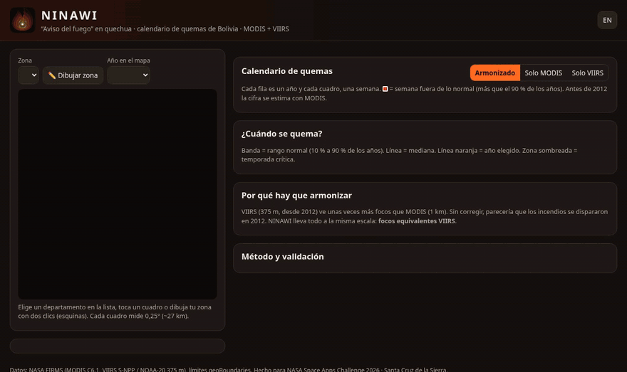
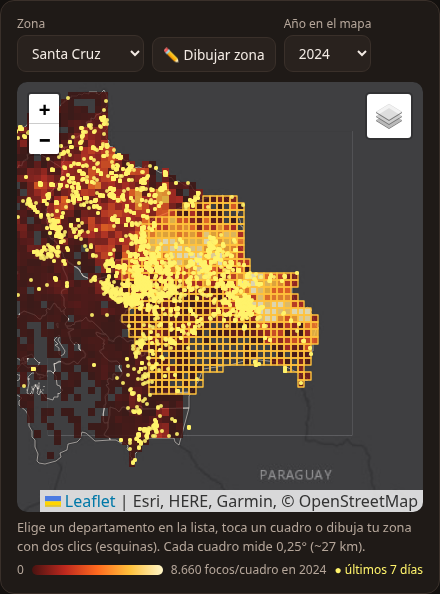
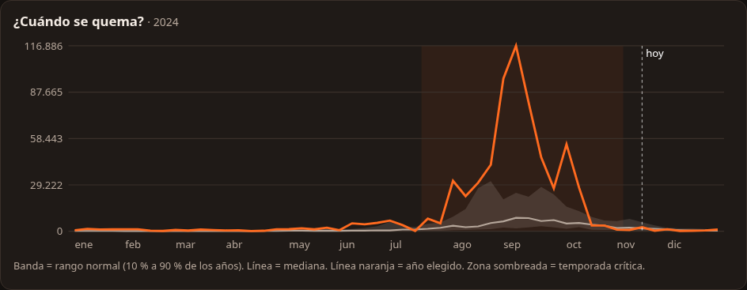
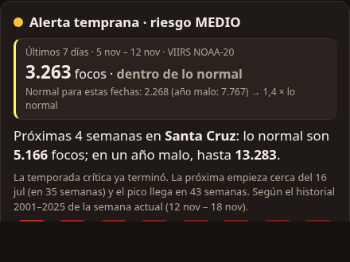
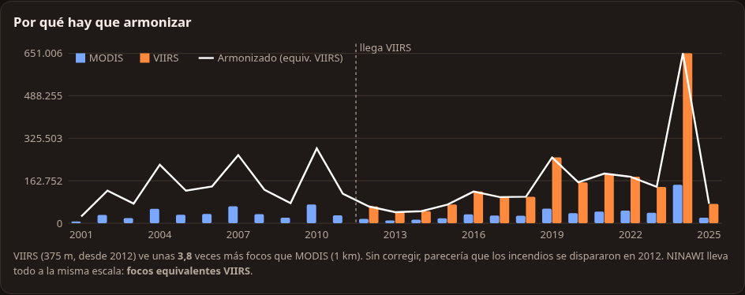
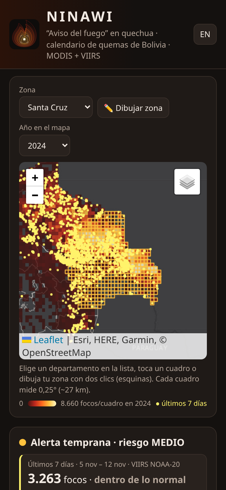
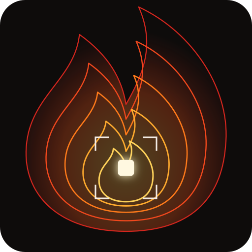

<div align="center">



### ¿Cuándo y dónde arde Bolivia? 25 años de satélites en una sola escala.

*Ninawi* viene del quechua **nina willay**: *aviso del fuego*.<br>
Proyecto para el **NASA Space Apps Challenge 2026**, desafío **Harmonization of MODIS and VIIRS Hot Spots**.

<a href="https://neckhurtttt.github.io/Ninawi/"></a>
<a href="https://neckhurtttt.github.io/Ninawi/?lang=en"></a>
<a href="https://neckhurtttt.github.io/Ninawi/#zona=Santa+Cruz&anio=2024"></a>






<sub>Santa Cruz → semanas de 2024 → <b>año 2019</b> → MODIS vs VIIRS vs armonizado → Beni → <b>zona dibujada a mano</b> → validación</sub>

</div>


## 🔥 El problema

Cada año, entre julio y octubre, Bolivia arde: chaqueos, incendios en la Chiquitanía y el Beni. En **2019** y **2024** se quemaron millones de hectáreas.

Los satélites de la NASA registran cada foco de calor desde 2001, pero con **dos sensores que no se pueden comparar directo**:

| | Sensor | Desde | Píxel | Focos |
|:-:|---|---|---|---|
| 🛰️ | **MODIS** (Terra y Aqua) | 2001 | 1 km | 1× |
| 🛰️ | **VIIRS** (S-NPP, NOAA-20/21) | 2012 | 375 m | **≈ 3,8×** |

Si los juntas sin corregir, parece que los incendios se **triplicaron en 2012**. Y MODIS ya está por apagarse. Así no hay forma honesta de responder: *¿este año es peor que lo normal?*

## 🛰️ Lo que hace NINAWI

Lleva los 25 años a **una sola escala** (focos *equivalentes VIIRS*) y los convierte en un **calendario de quemas** para cualquier zona de Bolivia.

<div align="center">

<br><sub>Datos reales: Santa Cruz, focos por semana, 2001–2025. Cada fila es un año; mientras más claro, más fuego.</sub>
</div>

<table>
<tr>
<td align="center" width="33%"><br><b>1 · ELIGE LA ZONA</b><br><sub>Departamento, un cuadro de 27 km o tu propia zona dibujada.</sub></td>
<td align="center" width="33%"><br><b>2 · MIRA EL CALENDARIO</b><br><sub>Temporada crítica, semana pico, años y semanas fuera de lo normal.</sub></td>
<td align="center" width="33%"><br><b>3 · RECIBE EL AVISO</b><br><sub>Los focos de esta semana comparados con 25 años de historia.</sub></td>
</tr>
</table>

## ✨ Lo que hay dentro

| | |
|---|---|
| 🗺️ **Mapa** | Cuadrícula de 0,25° por año, departamentos, zona propia con dos clics, focos de los últimos 7 días y vista satelital. |
| 📅 **Calendario de quemas** | Años × semanas. Se ve armonizado, solo MODIS o solo VIIRS, con las **semanas anormales** marcadas (más que el 90 % de los años). |
| 📈 **¿Cuándo se quema?** | Rango normal (percentiles 10–90), mediana y año elegido, con la **temporada crítica** sombreada (80 % de los focos). |
| 🚨 **Alerta temprana** | Focos de los últimos 7 días contra lo normal para esas fechas, y lo esperado en las próximas 4 semanas, con riesgo bajo, medio o alto. |
| 📉 **Tendencias** | Última década contra la primera, y si la temporada se **adelanta o se atrasa** (días por década). |
| 🧪 **Validación a la vista** | Tabla año por año: VIIRS real contra lo estimado solo con MODIS. |
| ⬇️ **Exportar y compartir** | CSV de la zona (semana a semana) y un enlace que guarda zona y año. |
| 📱 **Teléfono y PC** | Funciona en cualquier navegador, en español e inglés. |


## 🧪 Cómo se armoniza

<div align="center">

</div>

1. **Datos:** todos los focos de Bolivia de **NASA FIRMS**: MODIS C6.1 (2001–2025) y VIIRS S-NPP 375 m (2012–2025). Solo fuegos de vegetación (`type 0`); se descarta la confianza baja.
2. **Misma grilla:** cuadros de 0,25° (≈ 27 km) por semana.
3. **Factor por cuadro:** en los años con los dos sensores (2012–2025), `k = focos VIIRS / focos MODIS` en cada cuadro. Donde hay pocos datos, `k` se encoge hacia el valor nacional (≈ 3,8).
4. **Serie armonizada:** antes de 2012 se usa `MODIS × k` y desde 2012 VIIRS real. Así la serie **sigue funcionando cuando MODIS se apague**.
5. **Prueba dejando un año fuera:** para cada año de 2012 a 2025 se calcula `k` **sin ese año** y se estima VIIRS solo con MODIS.

| Métrica | Resultado |
|---|---|
| Correlación semanal por departamento | **r = 0,979** |
| R² (escala log) | 0,852 |
| Error anual mediano | **3,7 %** |

> Los focos son detecciones de calor, no área quemada: un incendio grande puede dar muchos focos.

## 📍 Lo que dicen los datos

- **Santa Cruz:** la temporada crítica va del **16 jul al 4 nov**, con pico la semana del **10 sep**. **2024 fue 5,2 veces lo normal**; 2010 fue 2,3 y 2007 fue 2,1. En la última década hubo **+34 %** de focos que en la primera.
- **Beni:** la temporada va del 16 jul al 28 oct, con pico la semana del 17 sep. Su peor año fue **2010**.


## 📱 En el teléfono

<div align="center">

</div>

## ▶️ Usarlo

**En línea:** https://neckhurtttt.github.io/Ninawi/ (en inglés: [`?lang=en`](https://neckhurtttt.github.io/Ninawi/?lang=en))

**En tu compu:**

```sh
cd web && python3 -m http.server 8000      # http://127.0.0.1:8000
```

**Regenerar los datos:**

```sh
# 1. CSV anuales de FIRMS por país (sin clave) a crudos/:
#    https://firms.modaps.eosdis.nasa.gov/data/country/{modis,viirs-snpp}/<año>/<sensor>_<año>_Bolivia.csv
python3 -I scripts/preparar.py crudos limites/bol-adm1.geojson web/datos   # armoniza y valida
python3 -I scripts/actualizar.py web/datos                                   # focos de los últimos 7 días
python3 -I scripts/readme_img.py                                             # imágenes de este README
```

Una **GitHub Action** baja cada día los focos nuevos (`actualizar.yml`) y vuelve a publicar la página (`pages.yml`).

## 🗂️ Estructura

- `web/`: la app (HTML, CSS y JS sin compilar, Leaflet local).
- `web/datos/focos.json`: 25 años armonizados por cuadro y semana, más la validación.
- `web/datos/ultimos7.json`: focos VIIRS de los últimos 7 días.
- `scripts/`: `preparar.py` (armonización y validación), `actualizar.py` (datos diarios) y `readme_img.py` (imágenes del README).
- `logo/generar.py`: el logo (isotermas, mira de detección y satélite) hecho con código.

## 🧰 Herramientas, datos y uso de IA

Space Apps pide documentar el software y los servicios de terceros. NINAWI usa:

| Qué | Para qué | Licencia / nota |
|---|---|---|
| [NASA FIRMS](https://firms.modaps.eosdis.nasa.gov/) (MODIS C6.1, VIIRS S-NPP, NOAA-20) | Focos de calor 2001–hoy | Datos abiertos de NASA |
| [geoBoundaries](https://www.geoboundaries.org/) | Límites de departamentos | CC BY 4.0 |
| [Leaflet](https://leafletjs.com/) 1.9.4 | Mapa | BSD-2 |
| Esri World Dark Gray / World Imagery | Mapa base y satelital | Atribución en el mapa |
| JetBrains Mono | Letra del logo y del README | SIL Open Font License |
| NumPy | Procesar 5,3 M de focos | BSD |
| Claude (Anthropic) | Asistente de IA usado para programar y redactar con el equipo | Las decisiones, el método y las pruebas son del equipo |


<div align="center">



**NINAWI** · *nina willay*, aviso del fuego · NASA Space Apps Challenge 2026 · Santa Cruz, Bolivia 🇧🇴

<sub>17.8°S · 63.2°W · ESCANEANDO</sub>

</div>
